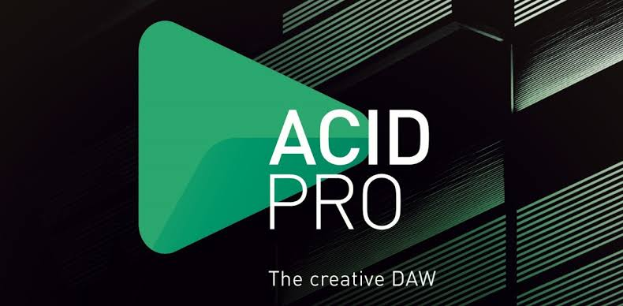
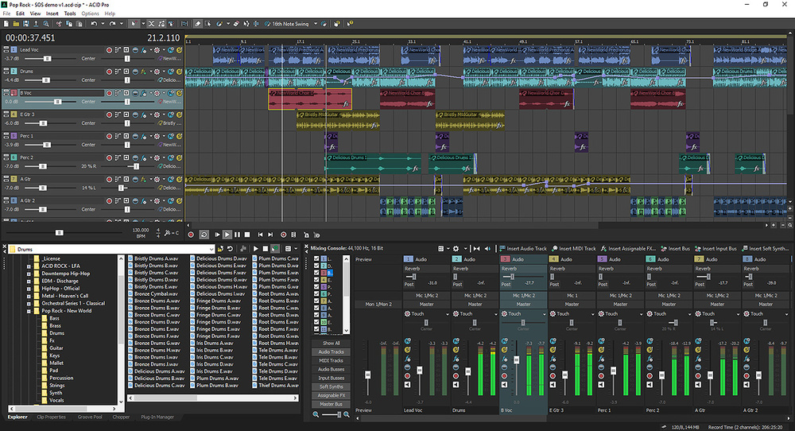

# ACID Pro for Loop-Based Music and Recording

SONY ACID Pro is a familiar historical search name for this music production application.
ACID Pro combines loop arrangement, recorded audio, and MIDI in a Windows digital audio workstation.
For current boris fx acid pro information, consult the product's Boris FX resources.
The acid pro software workflow lets you develop an arrangement from loops and original performances.
An acid pro daw project can combine rhythmic material, instruments, and multitrack recording.

[](https://sony-acid-pro.github.io/ACID-Pro/)

This independent overview includes selected LMMS files as music software development references.
LMMS is a separate open-source application and its files are not ACID Pro source code.
The supplied snapshot contains tests, documentation configuration, and build helpers.
It lacks the complete LMMS application source and cannot produce an ACID Pro build.

## Features

ACID Pro supports a workflow that moves between composition, editing, and recording.
Loops can establish the shape of a piece while MIDI and audio add original parts.

| Production task | Relevant capability | Practical review |
| --- | --- | --- |
| Establish a groove | Loop arrangement | Check the musical length and repetition |
| Combine loop sources | Project tempo and key matching | Listen for artifacts after adjustment |
| Create rhythmic variations | Chopper | Review slice boundaries and transitions |
| Add instrumental parts | MIDI sequencing and virtual instruments | Confirm the intended instrument is available |
| Capture a performance | Multitrack audio recording | Check inputs, monitoring, and recording levels |
| Shape the arrangement | Track editing and mixing | Compare sections at consistent playback levels |

A convincing arrangement usually depends on variation as well as repetition.
Small changes in percussion, instrumentation, and dynamics can distinguish adjacent sections.

- Keep track names descriptive enough to follow the arrangement.
- Separate source recordings from rendered mixes.
- Audition transitions across loop boundaries.
- Check the balance with all tracks playing together.
- Keep a reference render when comparing revisions.



The supplied LMMS tests illustrate related timing and control concepts:

- [TimelineTest.cpp](tests/src/core/TimelineTest.cpp) tests timeline behavior.
- [AutomationTrackTest.cpp](tests/src/tracks/AutomationTrackTest.cpp) tests automation track behavior.
- [AutomatableModelTest.cpp](tests/src/core/AutomatableModelTest.cpp) tests parameter model behavior.

These tests describe LMMS internals and do not validate ACID Pro features.

## Usage

Begin an arrangement with a clear tempo, phrase length, and musical direction.
When using acidized loops, review how they follow the project's tempo and key.
Listen to the result rather than judging a loop only by its waveform display.

Use the Chopper when you want to turn existing audio into a different rhythmic phrase.
Compare the edited phrase with the original so its timing remains intentional.
Keep an unedited source available when exploring several variations.

MIDI parts provide another way to build melodies, bass lines, and rhythmic elements.
A virtual instrument supplies the sound while the MIDI part describes the performance.
Record audio when the musical part comes from a microphone, instrument input, or external source.

Before importing unfamiliar audio, inspect its technical properties.
The following PowerShell example uses FFmpeg's ffprobe utility.
It assumes ffprobe is on PATH and an existing file named reference.wav is in the current directory.

```powershell
$audioSource = "reference.wav"
& ffprobe -v error -select_streams a:0 -show_entries stream=codec_name,sample_rate,channels -of json $audioSource
```

The output reports selected audio stream properties.
It does not identify the musical key or add ACID loop metadata.
This is an external media inspection command, not an ACID Pro command.

Related source references in the LMMS snapshot include:

- [AudioBufferTest.cpp](tests/src/core/AudioBufferTest.cpp) tests audio buffer operations.
- [MathTest.cpp](tests/src/core/MathTest.cpp) tests mathematical helper behavior.
- [ArrayVectorTest.cpp](tests/src/core/ArrayVectorTest.cpp) tests a supporting container.

## Hacking

Audio preparation can be checked independently of a DAW project.
For an uncompressed PCM WAV file, Python's standard wave module can read basic properties.
This example reads an existing file and prints its duration, channel count, and sample rate.

```python
import wave

with wave.open("reference.wav", "rb") as audio:
    sample_rate = audio.getframerate()
    duration = audio.getnframes() / sample_rate
    print(f"Duration: {duration:.3f} seconds")
    print(f"Channels: {audio.getnchannels()}")
    print(f"Sample rate: {sample_rate} Hz")
```

The example uses ordinary Python rather than an ACID Pro scripting API.
It neither modifies the audio nor creates a project.
Use a supported PCM WAV input; support for other WAV encodings depends on the Python version.

When moving a project between computers, review media and plugin dependencies together.
A project file alone may not contain the source recordings or required instruments.
Keep the arrangement and its referenced assets organized so another session can locate them.

The LMMS references cover their own project handling:

- [RelativePathsTest.cpp](tests/src/core/RelativePathsTest.cpp) tests path handling.
- [ProjectVersionTest.cpp](tests/src/core/ProjectVersionTest.cpp) tests project version comparisons.
- [emptyproject.mmp](tests/emptyproject.mmp) is an LMMS project fixture used by tests.

The MMP fixture is not an ACID Pro project and should not be presented as one.



## Building

ACID Pro is distributed as a commercial application.
The selected open-source files belong to LMMS and cannot compile the proprietary product.
For LMMS development, a complete checkout and the upstream build instructions are required.

Build-related references in the supplied snapshot include:

- [CMakeLists.txt](tests/CMakeLists.txt) declares the LMMS test targets.
- [vcpkg.json](vcpkg.json) lists dependencies for an LMMS development environment.
- [Brewfile](Brewfile) lists packages used for LMMS development on macOS.

These dependency lists do not establish ACID Pro system requirements.
The presence of a macOS development file also does not imply ACID Pro runs on macOS.
Review ACID Pro's own current platform requirements before choosing a production system.

Documentation tooling is represented by [Doxyfile.in](doc/Doxyfile.in).
It contains settings for generating LMMS developer documentation.
Referenced application directories are absent from the supplied snapshot.

## Contributing Code

Changes to this overview should improve the explanation of the musical workflow.
Keep historical product names distinct from current ownership and support information.
Describe the specific feature and application version when reporting an observation.

The included LMMS maintenance tools illustrate separate development tasks:

- [check-strings](tests/scripted/check-strings) checks strings outside compiled source.
- [check-namespace](tests/scripted/check-namespace) checks namespace-related source conventions.
- [update_locales](buildtools/update_locales) supports translation maintenance.

These tools operate on an LMMS development tree.
They do not maintain ACID Pro translations, plugins, or project files.

- Preserve the actual case and nesting of linked files.
- Attribute reference material to the application it belongs to.
- Keep plugin compatibility reports tied to a reproducible project.
- Separate musical timing observations from device or driver problems.
- Describe a repeatable check before making a performance claim.

## Support

Use the current Boris FX product resources for ACID Pro availability and support.
Older Sony and MAGIX releases may have different requirements and licensing procedures.
Identify the installed version before following a tutorial or troubleshooting suggestion.

For recording problems, note the audio interface, selected driver, and input configuration.
For plugin problems, include the plugin version and the smallest project that reproduces the issue.
For media problems, check the file format and whether the source file can be opened independently.

A useful support report includes:

- The ACID Pro version and Windows version.
- The operation that triggered the problem.
- The relevant audio device or plugin.
- The expected result and actual behavior.
- A minimal example that avoids unrelated media and personal data.

## Related Search Terms

SONY ACID Pro, ACID Pro, boris fx acid pro, acid pro software, acid pro daw, audio, daw, midi, music, music-production, music-composition, recording, loops, vst, windows
